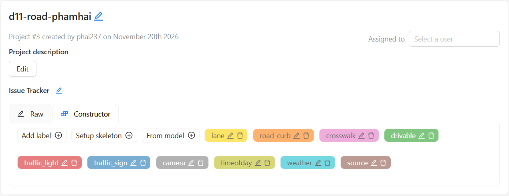
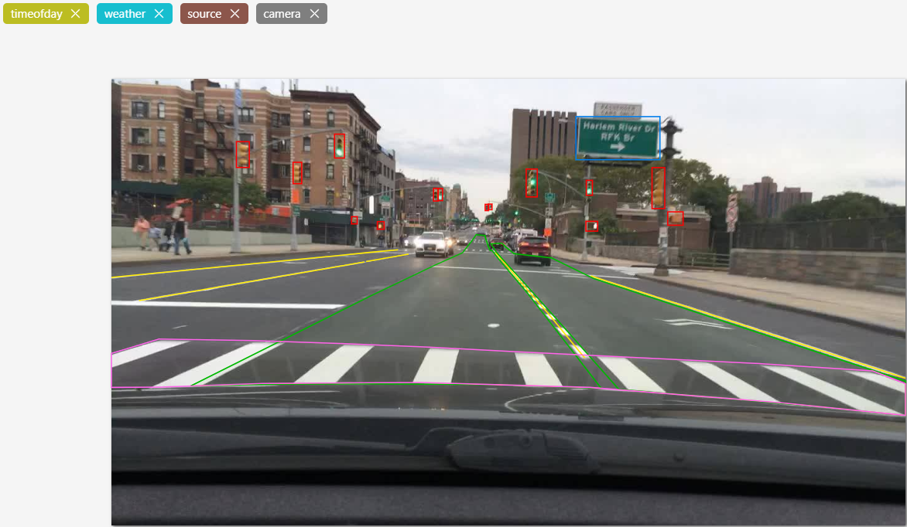
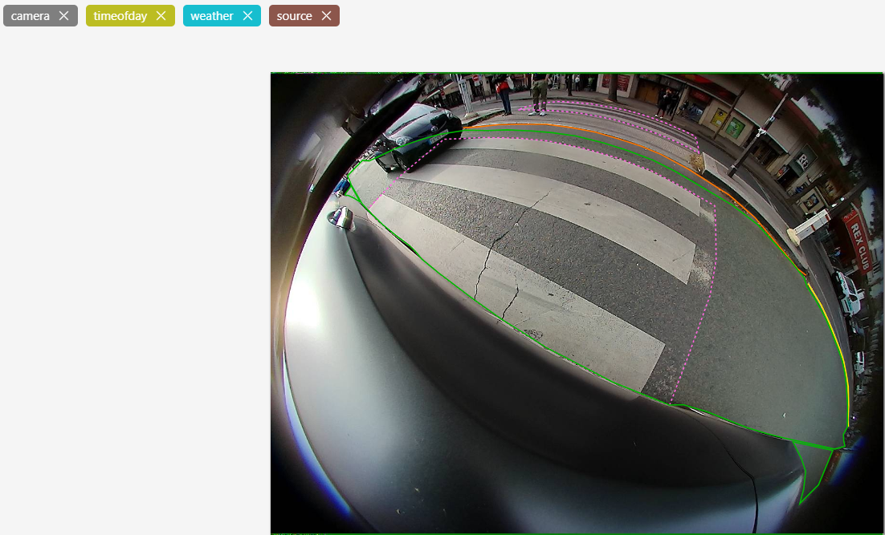
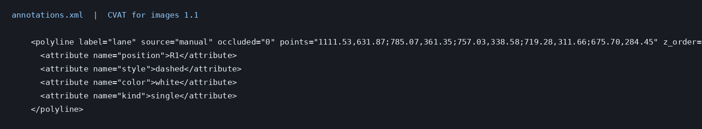

# Báo cáo cá nhân — Ngày 11

Họ tên: Phạm Hải  
Mã học viên: 2A202604047  
Phiên bản CVAT (Help → About): **Server 2.81.0, UI 2.81.0**  
Guideline: Road v1.0  
Lần nộp (`revision` trong manifest): **1**  
Thời điểm export: **21/11/2026** (front khoảng 10:58, fisheye khoảng 10:52 theo file tải về)  
Số lần nộp lại sau Rework: **0**

## 1. Kiểm project

| Mục | Đúng như guideline Road v1.0? | Ghi chú |
| --- | --- | --- |
| 6 label, đúng kiểu | Có | `lane`, `road_curb`: polyline; `crosswalk`, `drivable`: polygon; `traffic_light`, `traffic_sign`: rectangle. |
| Thuộc tính và giá trị | Có | Tôi kiểm trong XML xuất từ CVAT; các nhãn có thuộc tính theo Road v1.0. |
| 4 tag ảnh | Có | `camera`, `timeofday`, `weather`, `source`. Cả 20 ảnh đều có đủ bốn tag. |

Cách kết thúc polyline trên bản CVAT này: Tôi nhấn **N** sau khi đặt các điểm.  
Cách đặt tag ảnh trên bản CVAT này: Chọn tag `camera`, `timeofday`, `weather`, `source`, đặt giá trị ở thuộc tính `value`, rồi lưu.

## 2. Số lượng đã gán

| Task | Ảnh | lane | road_curb | crosswalk | drivable | traffic_light | traffic_sign |
| --- | ---: | ---: | ---: | ---: | ---: | ---: | ---: |
| front | 12 | 38 | 17 | 5 | 28 | 34 | 17 |
| front-extra (đã làm 0 / 4) | 0 | 0 | 0 | 0 | 0 | 0 | 0 |
| fisheye | 8 | 13 | 16 | 12 | 12 | 5 | 6 |
| fisheye-extra (đã làm 0 / 4) | 0 | 0 | 0 | 0 | 0 | 0 | 0 |

Tổng cộng **20 ảnh, 203 shape, 80 tag**. Các job đã chuyển sang **Completed**.

## 3. Bảng ca khó

| Ảnh | Nhãn | Phân vân giữa | Đã chọn | Lý do |
| --- | --- | --- | --- | --- |
| A01, A04, A09, A11 | `lane` | Vạch đôi vẽ một hay hai nét | Vẽ hai polyline | Coach hướng dẫn vẽ riêng từng nét sơn nên tôi giữ nguyên. |
| A08 | `lane` L1 | Cùng một đường nhưng có đoạn liền và đứt | Tách theo `style` | Đoạn `solid` và `dashed` khác nhau, không nên ép về một kiểu. |
| A05 | `lane` L1/R1 | Không thấy rõ vạch sơn | Chưa thêm | Tôi không muốn vẽ vạch không nhìn thấy; chờ coach kiểm ảnh. |
| A07 | `lane` L1 | Vạch sơn hay mép bê tông | Giữ `road_curb` | Phía trái giống mép đường hơn là vạch sơn; chờ coach xác nhận. |
| A09 | `lane` R1 | Vạch sơn hay mép đường | Chưa thêm R1 | Tôi chưa xác định được vạch rõ ràng ở mép phải. |
| B02–B04 | Đèn, biển | Bật `edge_zone` hay không | Đã sửa | Sau khi sửa, lint Set B không còn cảnh báo. |
| B05–B08 | `lane` | `position` của camera hai bên | Đổi thành `other` | Guideline yêu cầu camera trái/phải dùng `other`. |

## 4. Phiếu QC 1 nhận được

Bạn kiểm lô của tôi: **Phạm Văn Dương** (theo trao đổi; file QC hiện gửi vẫn ghi người kiểm là Phạm Hải/tự kiểm, cần bạn Dương sửa tên).  
Quyết định nhận được: **Hold** (theo file QC gửi ngày 21/11/2026; các ca mơ hồ chưa được coach trả lời).

| Mã lỗi | Số lỗi | Đồng ý? | Đã sửa? |
| --- | ---: | --- | --- |
| QC1-03 — `position` lane ở camera hai bên | 5 (ở bản trước, theo trao đổi) | Có | Có, trước lần export cuối |
| QC1-12 — điểm polygon lặp ở A08 | 1 (trên bản đang kiểm) | Có | Chưa |
| QC1-02 — chưa xác định rõ vạch ở A05, A07, A09 | 0 lỗi được xác nhận; 4 cảnh báo lint | Chờ coach | Chưa xác nhận |

Tôi đã sửa năm trường hợp `position` ở camera hai bên nên bản ZIP cuối không còn QC1-03 khi chạy lint. Phiếu QC Markdown bạn Dương gửi hiện ghi **0 lỗi QC1-03**, có thể là vì kiểm bản sau khi sửa; cần bạn ấy xác nhận lại quá trình kiểm. Điểm polygon lặp ở A08 vẫn còn trong bản đã nộp.

## 5. Kiểm file export

| File | Mở lại được? | Số shape ảnh 1 (job / file) | Số shape ảnh 2 (job / file) | Tag camera có trong XML? |
| --- | --- | --- | --- | --- |
| `phamhai-front.zip` | Có | **12 / 12** (A01) | **8 / 8** (A02) | Có, `front` |
| `phamhai-fisheye.zip` | Có | **5 / 5** (B01) | **7 / 7** (B02) | Có, `fisheye_front` |

Tôi chạy `road_check lint` trên hai ZIP cuối: đủ 20 ảnh, đủ tag, không kèm ảnh gốc và SHA-256 khớp manifest. Còn **10 cảnh báo**: bốn QC1-02 ở A05/A07/A09, năm QC1-05 về các lane cùng `position` và một QC1-12 ở A08. QC1-02 vẫn cần coach xác nhận ngoại lệ.

## 6. Ảnh chụp màn hình

1. Tab Labels của project (6 label và 4 tag): 
2. Một ảnh front đã gán đủ: 
3. Một ảnh fisheye có polyline cong: 
4. Đoạn XML có `<polyline label="lane">`: 

## 7. Tự đánh giá

Lỗi tôi phải sửa nhiều nhất là **QC1-03** khi gán lane ở camera bên và **QC1-11** ở phần `edge_zone`. Lần sau tôi sẽ kiểm thuộc tính ngay khi vừa vẽ xong, thay vì sửa một lượt lúc cuối. Các trường hợp không nhìn thấy vạch như A05, A07 và A09 thì cần hỏi coach sớm hơn.

Polyline `lane` được dùng để học vị trí vạch kẻ đường. Nếu tôi gán nhầm các lane từ camera hai bên thành L1/R1, dữ liệu đưa vào bước xử lý có thể hiểu sai đó là làn trước xe. Tôi đã sửa thành `other` để đúng với hướng camera.

## 8. (Tùy chọn, buffer) Từ polyline đến đích row-anchor

Không thực hiện phần tùy chọn.
